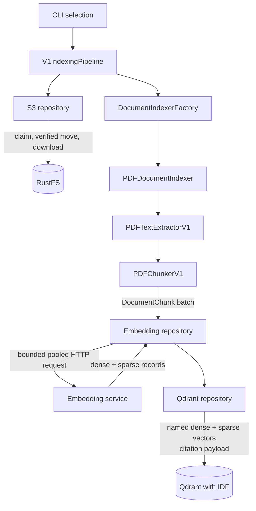

# Architecture

## Pipeline boundary

The indexing application is a one-shot job, not a long-running worker. A
single invocation processes the requested bucket selection, reports outcomes,
closes resources and exits.



The CLI, job contract, runner, side-effect-free mock, S3 repository, repository
factory, conditional processing workflow, embedded PDF text extraction, chunk
creation, remote embedding calls, and Qdrant persistence exist today.

Dense vectors use multilingual E5 inference. Sparse vectors reuse the same
pinned tokenizer without dense-only prefixes, store positive token-frequency
weights, and rely on Qdrant's configured sparse IDF modifier. The embedding
repository validates that both ordered batches align before the pipeline writes
any point.

## Implemented repository layout

```text
app/
├── chunkers/           # PDFChunkerV1 and chunking result contract
├── common/
│   ├── settings/       # grouped Pydantic settings, including Qdrant
│   └── utility/        # safe object-key-to-path conversion
├── document_indexers/  # MIME-selected document processing boundary
├── document_extractors/# local text extraction and ExtractedPage models
├── jobs/               # v1 and offline mock top-level jobs
├── pipelines/          # BasePipeline startup/cleanup contract
└── repository/
    ├── base.py         # shared repository lifecycle
    ├── factory.py      # infrastructure provider selection
    ├── models.py       # Pydantic bucket/object records
    ├── embedding_service/ # HTTPX embedding-service adapter
    ├── vector/         # base, registry factory, and provider implementations
    └── s3/             # S3 contract and boto3 implementation
```

## Pipeline selection

`IndexingPipelineRegistry` maps stable CLI names to factories that construct
`AsyncIndexingJob` implementations. `app.main` owns the explicit registrations;
the shared CLI resolves `--pipeline` and passes the remaining validated job
arguments to the selected factory. Only executable pipelines are registered.

This top-level registry answers "which job should run?" It remains separate
from `DocumentIndexerFactory`, which answers "how should this content type be
indexed?", and capability-specific repository factories, which answer "which
provider implements this infrastructure capability?"

## Validated data models

Command inputs, job arguments, pipeline registrations, and chunk metadata use
frozen Pydantic `BaseModel` classes. Pydantic performs boundary validation,
rejects unknown fields, and provides predictable serialization without making
behavior-oriented jobs or registries inherit from a data-model base class.

Environment-backed application configuration must use
`pydantic-settings.BaseSettings`. Direct environment access belongs in a
settings composition boundary rather than repositories, use cases, or jobs.
`VECTOR_PROVIDER` selects the registered vector implementation (currently
`qdrant`); provider-specific `QDRANT_*` settings configure only that adapter.

## Clean Architecture placement

Repositories own external access to RustFS/S3, embedding providers and Qdrant.
Use cases own one application operation and normally depend on one repository.
A controller coordinates multiple use cases for the full document pipeline.
The composition layer creates repositories, use cases, the controller and the
concrete job; business methods must not construct infrastructure clients.

`VectorRepositoryFactory` registers vector implementations under stable provider
enum keys and constructs the configured implementation through `VectorRepositoryBase`.
The Qdrant implementation, base contract, models, and factory are colocated in
`app/repository/vector/`; pipelines do not depend on a Qdrant-specific type.
`EmbeddingRepositoryFactory` similarly registers the HTTPX implementation and
the explicit, unimplemented `FallBackLocalEmbeddingFactory` compatibility path.
`DocumentIndexerFactory` separately selects a document implementation
from normalized content type. It maps `application/pdf` to a
`PDFDocumentIndexer` composed with `PDFTextExtractorV1` and `PDFChunkerV1`;
unsupported types are reported and skipped per object. Indexing startup creates
one `httpx.AsyncClient` with limits derived from `--concurrency` and injects it
into `EnterpriseEmbeddingServiceRepository`.

## Source metadata

Every stored chunk must retain at least:

| Field | Purpose |
| --- | --- |
| `source_bucket` | RustFS/S3 bucket used for retrieval and citation |
| `object_key` | Original object location within the bucket |
| `document_id` | Deterministic identity for retries |
| `chunk_id` | Deterministic vector point identity |
| `page_number` | Original PDF page when known |

Additional useful metadata includes content type, checksum, chunk ordinal,
embedding model and indexing timestamp. Do not store secrets or log complete
document contents.

## Retry and overlap rules

S3 object movement is copy-then-delete and is not an atomic lock. A conditional
claim marker selects one job before movement. The processing copy is verified
before source deletion, and deterministic processing keys support recovery.
Claims are leases rather than transactions: a hard termination leaves a marker
until its TTL, and an incorrectly short TTL can allow overlap. Deterministic IDs
make Qdrant retries idempotent. Removing stale points when a changed document
produces fewer chunks remains a known limitation.
